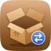
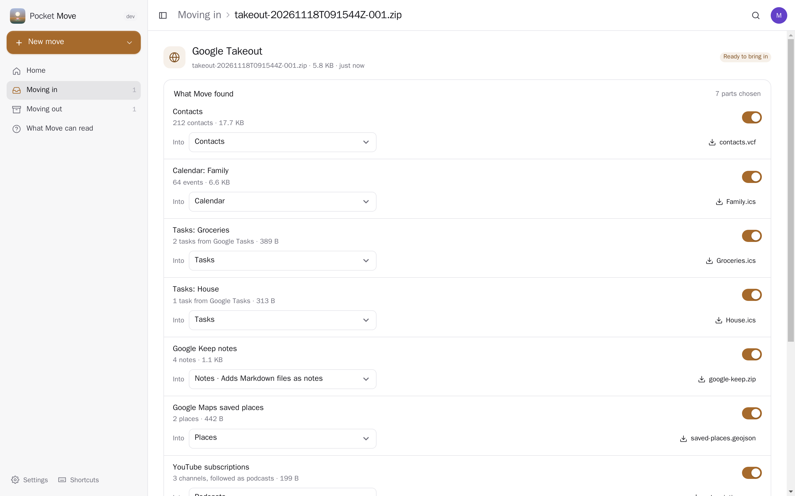
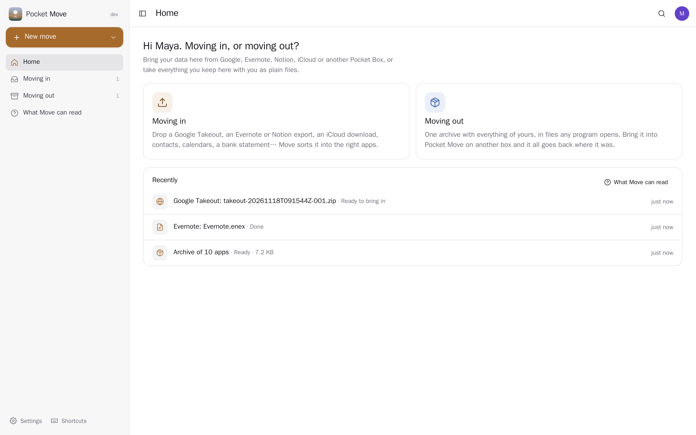
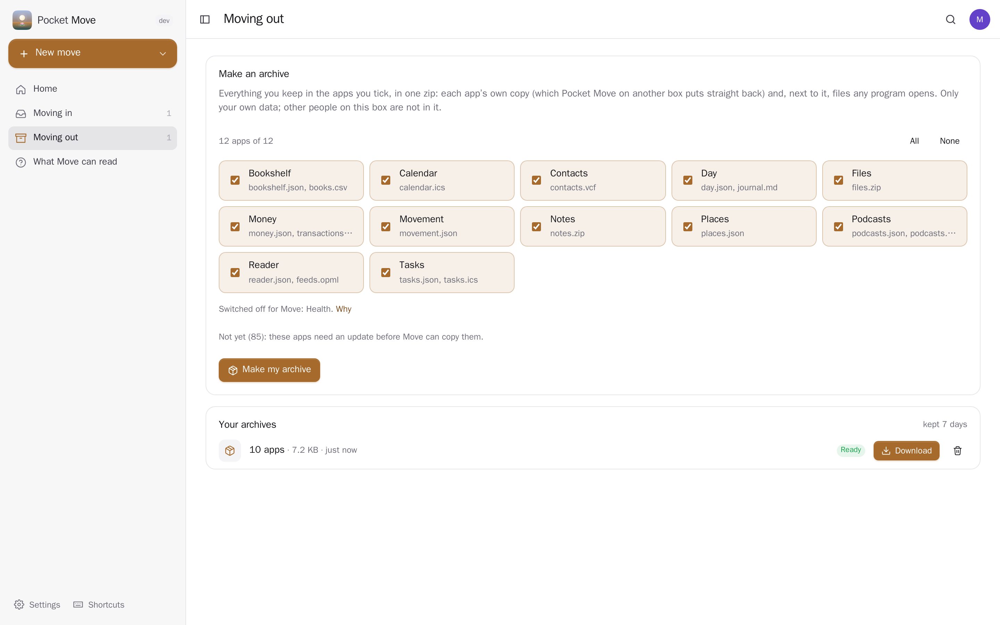
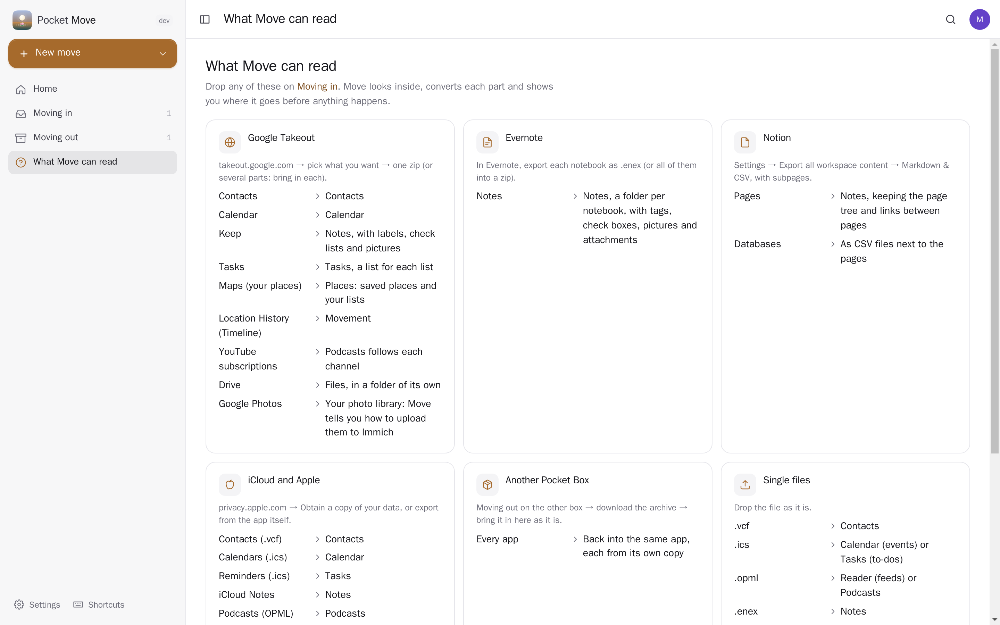
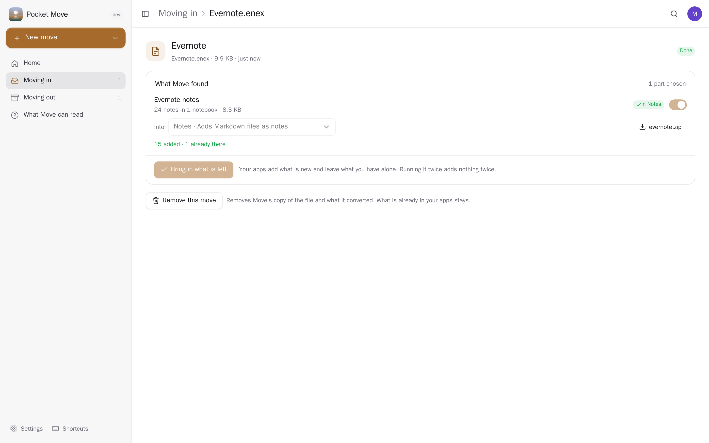
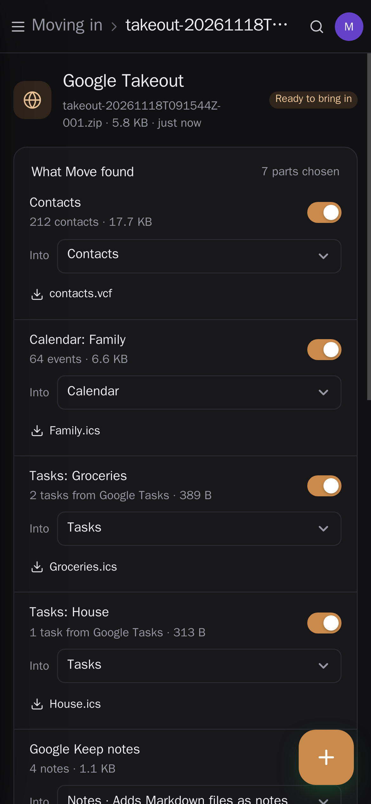
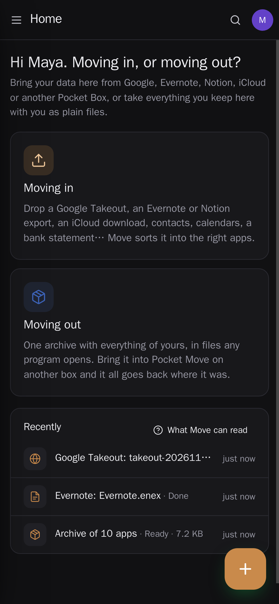

<p align="center"></p>
<h1 align="center">Pocket Move</h1>
<p align="center">Moving in and out of your own server. Bring your data in from Google Takeout, Evernote, Notion, iCloud or another Pocket Box and Move sorts each part into the right app; take everything with you as one archive of files any program opens. One Go binary, one SQLite file, one volume. Part of the Pocket apps; works on its own too.</p>
<p align="center">
  <a href="https://github.com/abjelosevic88/pocket-homelab-move/actions"></a>
  <a href="https://github.com/abjelosevic88/pocket-homelab-move/pkgs/container/pocket-homelab-move"></a>
  <a href="LICENSE"></a>
</p>

---

<p align="center"></p>

<table>
  <tr>
    <td width="50%"></td>
    <td width="50%"></td>
  </tr>
  <tr>
    <td align="center"><sub>Moving in or moving out, and what you did lately.</sub></td>
    <td align="center"><sub>Moving out: every app that can, in one zip with a README and a manifest.</sub></td>
  </tr>
  <tr>
    <td width="50%"></td>
    <td width="50%"></td>
  </tr>
  <tr>
    <td align="center"><sub>What Move can read, and where each part goes.</sub></td>
    <td align="center"><sub>An Evernote export, brought into Notes: notebooks as folders, tags, check boxes, pictures.</sub></td>
  </tr>
</table>

<p align="center">
  &nbsp;&nbsp;
  
</p>

## What it does

- **Moving in**: drop a file of any size. Move looks inside and shows what it found and where each part goes, before anything happens:
  - **Google Takeout**: contacts, calendars, Keep notes (labels, check lists, pictures), Tasks (a list for each list, subtasks, due dates), Maps saved places and lists, location history, YouTube subscriptions (followed as podcasts), Drive.
  - **Evernote** (.enex): notes as Markdown, a folder per notebook, tags, check boxes, tables, pictures and attachments.
  - **Notion** (Markdown & CSV export): the page tree, links between pages kept, without Notion's ids.
  - **iCloud and Apple**, **Obsidian / Bear / Markdown**, **.vcf, .ics, .opml, .gpx**, **Goodreads / StoryGraph** CSV and **bank statements**.
  - **Another Pocket Box**: a Pocket Move archive goes back app by app.
- **Your apps add, never delete**: a second run of the same file adds nothing twice; Move marks what you brought in before.
- **Moving out**: one zip of everything you keep in the apps you tick: each app's own copy, files any program opens next to it (.ics, .vcf, Markdown, CSV, OPML, GPX), a `README.html` saying what each file is and a `manifest.json` with checksums.
- **By hand where it must be**: passwords are encrypted on your own devices, so Move tells you how to import them in Pocket Vault and deletes its copy at once; photos go to Immich with its own uploader.
- **Everyone their own**: each person moves only their own data; admins see no one else's moves or archives.

## Run it

```sh
docker run -d --name pocket-move -p 8080:8080 -v ./data:/data \
  -e BASE_URL=https://move.example.com -e SECURE_COOKIES=true \
  ghcr.io/abjelosevic88/pocket-homelab-move:latest
```

or `docker compose up -d` with [docker-compose.yml](docker-compose.yml). All options: [docs/configuration.md](docs/configuration.md). API: [docs/api.md](docs/api.md).

On its own, Move reads and converts what you bring in, and you download the converted files (Evernote or Keep as Markdown, Google Tasks as .ics…).

## With Pocket Core

Set `CORE_URL` and `CORE_REGISTRATION_KEY` and Move joins the box: people sign in with Pocket Core, and Move reaches each person's apps through Core app links, `move:export` and `move:import`, which every Pocket app offers once it declares Pocket Core's `Portable` (see `docs/move.md` in [pocket-homelab-core](https://github.com/abjelosevic88/pocket-homelab-core)). The links start off; switch them on in Core → Links. Move never holds anyone's keys: every call is a five-minute pass for one person in one app.

## Develop

```sh
make dev     # API on :8080 with demo data and stand-in apps + Vite on :5173
make test    # go vet, go test, tsc
make         # web + binary
```

MIT licensed.
